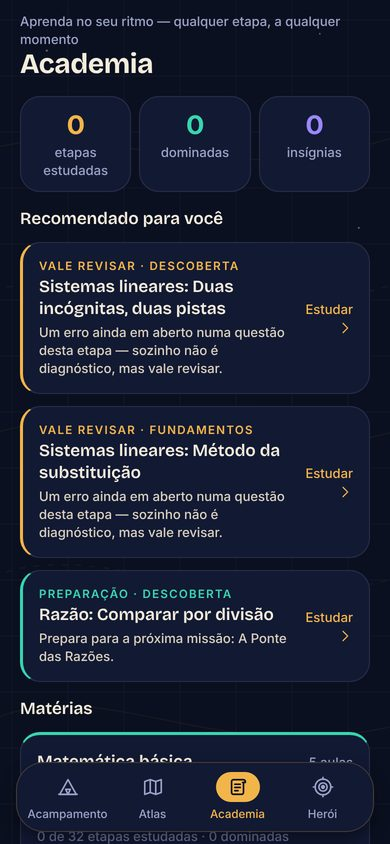
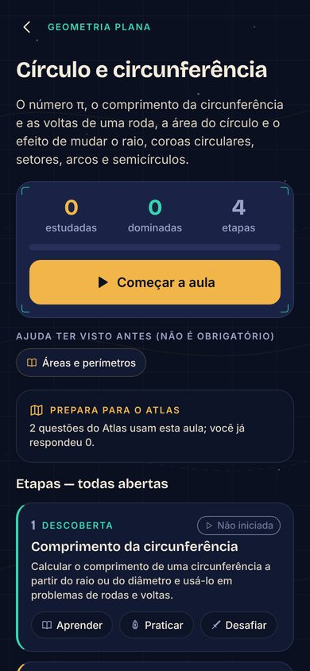
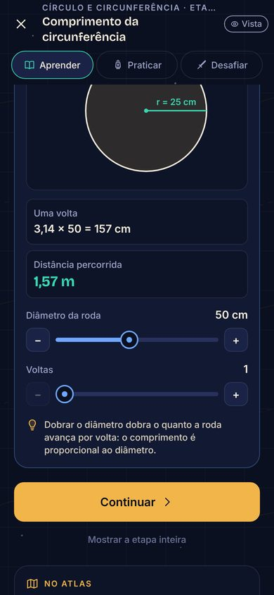
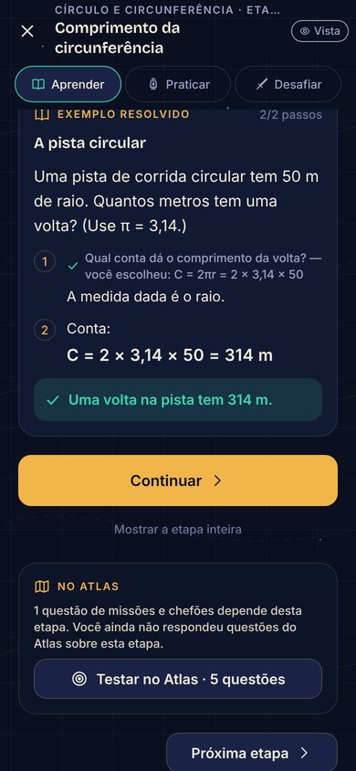
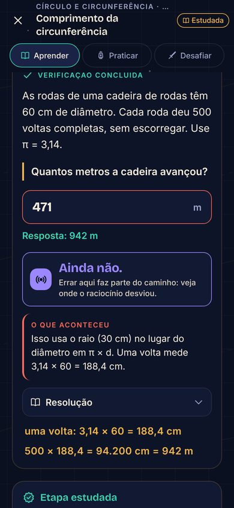

# QuestForge — RPG de matemática para o ENEM

Você é um **Cartógrafo** num mundo cujo mapa foi apagado pela Névoa do Esquecimento.
Cada questão de matemática resolvida redesenha um pedaço do Atlas, forja o seu astrolábio
e enfraquece os guardiões das regiões. Estudar é evoluir — e o app separa com honestidade
**esforço** (XP), **território** (campanha) e **aprendizado real** (domínio e revisão espaçada).

| Acampamento | Questão | Erro vira Eco | Subida de nível | Chefão |
| --- | --- | --- | --- | --- |
|  |  |  |  |  |

| Onboarding | Atlas | Golem Proporcional | Vitória | Herói |
| --- | --- | --- | --- | --- |
|  |  |  |  |  |

| Academia | Aula | Laboratório | Exemplo guiado | Verificação |
| --- | --- | --- | --- | --- |
|  |  |  |  |  |

> Capturas da pré-visualização web, geradas pelos testes ponta a ponta (`scripts/e2e-web.js` e `scripts/e2e-academy.js`).

## Documentos do projeto

- [`PROJECT_PLAN.md`](PROJECT_PLAN.md) — visão, mecânicas, economia, direção de arte e roteiro.
- [`ARCHITECTURE.md`](ARCHITECTURE.md) — stack, camadas, banco local, conteúdo e qualidade.
- [`TASKS.md`](TASKS.md) — o que está **implementado e testado** e o que está pendente.
- [`docs/ACADEMIA.md`](docs/ACADEMIA.md) — a Academia: cursos, etapas, integrações e como escrever aulas.

## Academia

A aba **Academia** ensina o conteúdo antes (e depois) das batalhas: **13 cursos, 40 aulas e
197 etapas**, cobrindo os 38 subassuntos do banco. Cada aula avança por etapas — Descoberta,
Fundamentos, Interpretação, Aplicações, Aprofundamento e Maestria —, todas abertas desde o
início, e cada etapa tem três modos:

- **Aprender**: explicação curta, laboratórios com uma missão, simulações, exemplos em que se
  escolhe o próximo passo e verificações com feedback para cada erro previsível;
- **Praticar**: exercícios gerados (versões novas a cada vez), com dicas graduais e resolução;
- **Desafiar**: problemas sem ajuda; passar marca a etapa como dominada, com revisões em 3, 7,
  16 e 35 dias.

Errar nunca tira XP, Tinta ou domínio. As 644 questões do Atlas apontam para a etapa que ensina
o que elas exigem: depois de um erro, o feedback explica a alternativa escolhida e oferece
**Rever na Academia**; resumos e Acampamento recomendam etapas; e cada etapa dominada nas aulas
de um chefão soma até +15% de dano na batalha. Detalhes em [`docs/ACADEMIA.md`](docs/ACADEMIA.md).

## Folha de resolução

As 314 questões têm uma folha visual com raciocínio numerado, contas e resposta final,
incluindo frações numéricas com traço. Ela abre após um erro e também está no histórico
e nos exemplos do reforço guiado. As explicações existentes foram preservadas; mais de
60 resoluções ganharam conversões, substituições ou operações intermediárias explícitas.

A folha usa texto nativo, lê sem internet e acompanha o tamanho de fonte do aparelho.
Não depende de IA nem de imagens baixadas. Consultá-la não altera XP, domínio ou o
prazo dos Ecos. A validação do banco exige contas em cada questão; `--solutions-only`
no roteiro web verifica todo o catálogo offline em 320 px. Android físico e TalkBack
continuam pendentes; não há exportação de PNG no app.

## Rodar no Android

**APK mais recente: 0.2.2, versionCode 6 (19/10/2026), com abertura simples: nome QuestForge sobre fundo escuro.**
[Baixar o APK](https://expo.dev/artifacts/eas/d71nE-3SeNo8boEJvqkZxrpGoLaYUhSEmJYHx9DIpF4.apk).
Instale por cima da versão atual, **sem desinstalar**, para manter o progresso.
Pacote e assinatura foram conferidos como idênticos aos anteriores. O runtime é `0.2.2`;
o APK já contém o painel de evolução, reforço guiado e as 314 folhas de resolução.
A abertura simples exige este APK; não chega por EAS Update. O ícone do livro e da estrela foi mantido. [Detalhes da arte e da abertura](docs/app-icon.md).

Requisitos: Node.js 20+ (testado com 22) e npm.

```bash
npm install
```

> **Desde a v0.3.0 o app não roda mais no Expo Go**: o login Google usa um módulo nativo próprio
> (`react-native-nitro-google-signin`). Use um build nativo (APK ou `expo run:android`). Antes, configure o Firebase
> ([`docs/CLOUD_SETUP.md`](docs/CLOUD_SETUP.md)) e copie `.env.example` para `.env`. Para depurar o login, gere o APK
> `preview` (opções abaixo); um *development build* exigiria acrescentar `expo-dev-client`.
> A pré-visualização web (`npx expo start --web`) continua funcionando sem login real e sem nuvem.

**Opção 1 — build local** (precisa do Android Studio/SDK e de um emulador ou aparelho com depuração USB):

```bash
npx expo run:android
```

**Opção 2 — APK instalável pela nuvem (EAS)**, sem Android Studio:

```bash
npx eas-cli@latest build -p android --profile preview
```

Ao final, o EAS fornece um link para baixar o `.apk`. O perfil `preview` assina com a
mesma chave do APK já instalado (`credentials/`), então ele instala **por cima** e o
progresso continua lá. Nunca distribua um APK assinado com outra chave: o Android
recusaria a atualização e a única saída seria desinstalar — apagando o progresso.

## Atualizações pela internet (sem APK novo)

O APK instalado procura versões novas ao abrir (e ao voltar para o app). Para publicar
uma mudança de código (telas, regras, questões):

```bash
npx eas-cli@latest update --channel preview --environment preview --platform android --message "o que mudou"
```

Na próxima abertura o app baixa a versão; o Acampamento mostra **Atualizar agora**
(ou ela entra sozinha na abertura seguinte). O progresso fica no SQLite do aparelho e
não é tocado — a versão nova só roda as migrações pendentes.

Mudou algo **nativo** (nova biblioteca com código nativo, permissões, ícone, `app.json`
de plataforma)? Aí é preciso um APK novo: suba `version` e `android.versionCode` no
`app.json` e gere o APK com a mesma chave. A `runtimeVersion` segue a `version`, então
um APK antigo nunca recebe código que dependa de nativo que ele não tem.

## Publicação e reversão

Última atualização publicada: **22/10/2026 — 330 questões novas, chefes animados e Convergência**,
código `b1777c0`, Android, runtime `0.3.0` (APK versionCode 7):

- `preview`: grupo `3de15c8f-626e-43ec-a87a-385756ca0441`;
- `production`: grupo `1e8a3a63-9125-46e7-aa10-201dcf3f49da`.

Manifestos e SHA-256 dos bundles baixados foram conferidos. QA e migração de legado ficaram desativados.
O banco tem 644 questões, com os IDs antigos preservados. Apps 0.2.x não recebem esta atualização.
Detalhes de validação em [docs/QUESTOES_E_CHEFES.md](docs/QUESTOES_E_CHEFES.md).

Se for preciso reverter uma funcionalidade, preserve as 644 questões e seus IDs na publicação corretiva:
sessões em andamento podem referenciar itens novos. Não restaure diretamente o banco antigo de 314 itens
sem tratar essas referências; o progresso deve permanecer no banco do aparelho e na nuvem.

## Verificações

```bash
npm test                 # 622 testes: domínio, Academia, evolução, reforço guiado, conteúdo, efeitos, SQLite real e atualização
npm run typecheck        # TypeScript estrito
npm run lint             # ESLint (config Expo + regras de hooks do React)
npm run validate:content # validadores do banco de questões e da Academia
npx expo export --platform android   # garante que o bundle nativo compila
```

Teste ponta a ponta no navegador (opcional, requer Playwright):

```bash
EXPO_PUBLIC_QA=1 npx expo export --platform web --output-dir dist-web
python3 -m http.server 8090 --directory dist-web &
node scripts/e2e-web.js e2e-shots http://localhost:8090/
node scripts/e2e-academy.js e2e-academy-shots http://localhost:8090/   # Academia
```

Para verificar só a primeira expedição e as telas de evolução/histórico, acrescente
`--learning-only` ao comando do roteiro. Se o Chromium estiver instalado fora do
Playwright, informe seu executável em `PLAYWRIGHT_CHROMIUM_EXECUTABLE_PATH`.

No Acampamento, **Sua evolução** abre o gráfico da semana e o mapa de domínio por
subassunto. **Histórico de erros** permite consultar as tentativas anteriores e suas
resoluções, sem gastar ou ganhar recompensas. O painel também está no Herói.

Nas expedições e missões, dois erros seguidos no mesmo subassunto podem oferecer
**Ver exemplo resolvido** antes da prática mais acessível. O exemplo é outro item
validado, separado da avaliação; sua leitura não dá XP nem conta como resposta.
É possível pausar e retomar essa etapa. Sem exemplo adequado no banco, continua
valendo o reforço com questão mais acessível e conceito. O roteiro
`node scripts/e2e-web.js e2e-shots http://localhost:8090/ --scaffold-only`
verifica leitura, retomada e retorno à prática.

Com `EXPO_PUBLIC_QA=1` também existe o laboratório de efeitos `/vfx-lab` (grades de núcleos,
auras e sinergias: `?grid=cores|auras|synergy`; combinação única: `?core=…&aura=…&fx=alto|medio|baixo`).
Rotas diretas como essa precisam de um servidor com *fallback* para `index.html`.

## Estrutura

```
src/
  app/       telas (Expo Router)          domain/   regras puras: XP, níveis, revisão, batalha
  features/  composição de telas          content/  questões, assuntos, regiões, chefões, itens
  ui/        design system                data/     SQLite: migrações e repositório atômico
  state/     store + ações (domínio → persistência → tela) e sessão (conta → banco → nuvem)
  auth/      login Google (Credential Manager) + Firebase Auth + sessão no cofre do sistema
  sync/      snapshot, merge de 3 vias e motor de sincronização (puros, testados em Node)
  platform/  Android (SQLite por conta + Firebase) × pré-visualização web (memória)
  legacy/    migração única do progresso antigo (só builds de desenvolvimento)
```

Privacidade: entrada com conta Google (única forma de conta), sem anúncios e sem telemetria. O progresso fica no
aparelho e é sincronizado com a conta (Firebase). Detalhes em [docs/PRIVACY.md](docs/PRIVACY.md).

## Contas e nuvem

- Arquitetura e decisões: [docs/CLOUD_SYNC.md](docs/CLOUD_SYNC.md)
- Configurar o Firebase e o login Google (o que depende de você): [docs/CLOUD_SETUP.md](docs/CLOUD_SETUP.md)
- Preservar o progresso anterior às contas (procedimento único): [docs/LEGACY_MIGRATION.md](docs/LEGACY_MIGRATION.md)
- `npm run test:rules` — regras de segurança e sincronização contra os emuladores do Firebase (exige Java)
- `npm run verify:no-legacy` — confere que a ferramenta de migração única não está no bundle de produção
