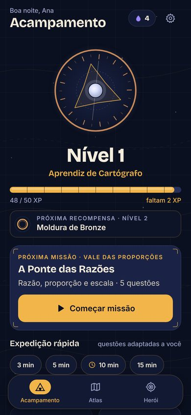
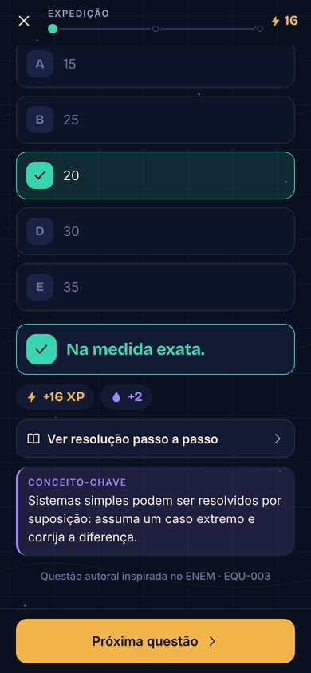
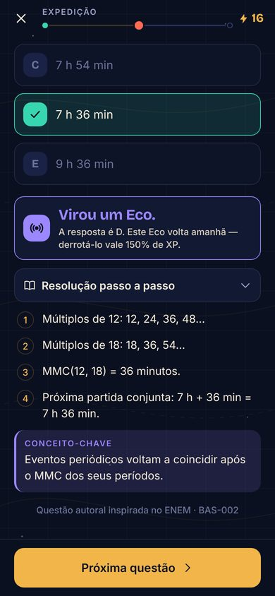
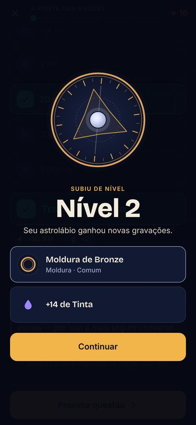
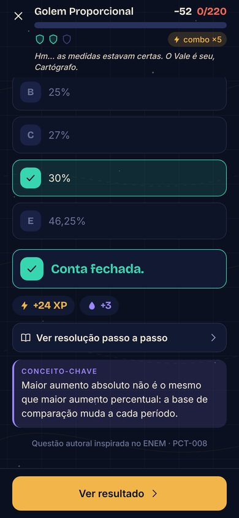
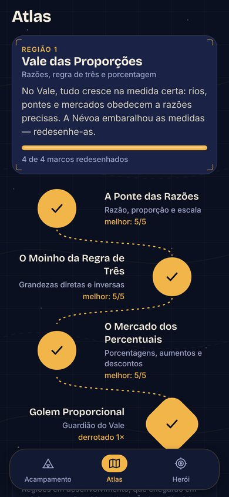
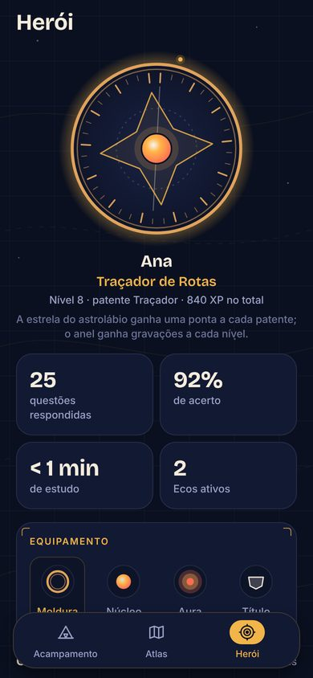

# QuestForge — RPG de matemática para o ENEM

Você é um **Cartógrafo** num mundo cujo mapa foi apagado pela Névoa do Esquecimento.
Cada questão de matemática resolvida redesenha um pedaço do Atlas, forja o seu astrolábio
e enfraquece os guardiões das regiões. Estudar é evoluir — e o app separa com honestidade
**esforço** (XP), **território** (campanha) e **aprendizado real** (domínio e revisão espaçada).

| Acampamento | Questão | Erro vira Eco | Subida de nível | Chefão |
| --- | --- | --- | --- | --- |
|  |  |  |  |  |

| Onboarding | Atlas | Golem Proporcional | Vitória | Herói |
| --- | --- | --- | --- | --- |
|  |  |  |  |  |

> Capturas da pré-visualização web, geradas pelo teste ponta a ponta (`scripts/e2e-web.js`).

## Documentos do projeto

- [`PROJECT_PLAN.md`](PROJECT_PLAN.md) — visão, mecânicas, economia, direção de arte e roteiro.
- [`ARCHITECTURE.md`](ARCHITECTURE.md) — stack, camadas, banco local, conteúdo e qualidade.
- [`TASKS.md`](TASKS.md) — o que está **implementado e testado** e o que está pendente.

## Folha de resolução

As 314 questões têm uma folha visual com raciocínio numerado, contas e resposta final,
incluindo frações numéricas com traço. Ela abre após um erro e também está no histórico
e nos exemplos do reforço guiado. As explicações existentes foram preservadas; mais de
60 resoluções ganharam conversões, substituições ou operações intermediárias explícitas.

A folha usa texto nativo, lê sem internet e acompanha o tamanho de fonte do aparelho.
Não depende de IA nem de imagens baixadas. Consultá-la não altera XP, domínio ou o
prazo dos Ecos. A validação do banco exige contas em cada questão; `--solutions-only`
no roteiro web verifica todo o catálogo offline em 320 px. Android físico e TalkBack
continuam pendentes; não há exportação de PNG no app.

## Rodar no Android

**APK mais recente: 0.2.2, versionCode 6 (19/10/2026), com abertura simples: nome QuestForge sobre fundo escuro.**
[Baixar o APK](https://expo.dev/artifacts/eas/d71nE-3SeNo8boEJvqkZxrpGoLaYUhSEmJYHx9DIpF4.apk).
Instale por cima da versão atual, **sem desinstalar**, para manter o progresso.
Pacote e assinatura foram conferidos como idênticos aos anteriores. O runtime é `0.2.2`;
o APK já contém o painel de evolução, reforço guiado e as 314 folhas de resolução.
A abertura simples exige este APK; não chega por EAS Update. O ícone do livro e da estrela foi mantido. [Detalhes da arte e da abertura](docs/app-icon.md).

Requisitos: Node.js 20+ (testado com 22) e npm.

```bash
npm install
```

**Opção 1 — Expo Go (mais rápida).** Instale o Expo Go compatível com o SDK 57 no celular e rode:

```bash
npx expo start
```

Escaneie o QR code com o Expo Go. Todas as bibliotecas nativas usadas (SQLite, Reanimated,
SVG, Haptics) fazem parte do Expo Go.

**Opção 2 — build local** (precisa do Android Studio/SDK e de um emulador ou aparelho com depuração USB):

```bash
npx expo run:android
```

**Opção 3 — APK instalável pela nuvem (EAS)**, sem Android Studio:

```bash
npx eas-cli@latest build -p android --profile preview
```

Ao final, o EAS fornece um link para baixar o `.apk`. O perfil `preview` assina com a
mesma chave do APK já instalado (`credentials/`), então ele instala **por cima** e o
progresso continua lá. Nunca distribua um APK assinado com outra chave: o Android
recusaria a atualização e a única saída seria desinstalar — apagando o progresso.

## Atualizações pela internet (sem APK novo)

O APK instalado procura versões novas ao abrir (e ao voltar para o app). Para publicar
uma mudança de código (telas, regras, questões):

```bash
npx eas-cli@latest update --channel preview --environment preview --platform android --message "o que mudou"
```

Na próxima abertura o app baixa a versão; o Acampamento mostra **Atualizar agora**
(ou ela entra sozinha na abertura seguinte). O progresso fica no SQLite do aparelho e
não é tocado — a versão nova só roda as migrações pendentes.

Mudou algo **nativo** (nova biblioteca com código nativo, permissões, ícone, `app.json`
de plataforma)? Aí é preciso um APK novo: suba `version` e `android.versionCode` no
`app.json` e gere o APK com a mesma chave. A `runtimeVersion` segue a `version`, então
um APK antigo nunca recebe código que dependa de nativo que ele não tem.

## Publicação e reversão

Última atualização publicada: **19/10/2026 — folhas de resolução nas 314 questões**,
código `4efea8a`, grupo Expo `7c181e15-f117-4da2-b32e-ec12992a7e93`, Android,
canal `preview`, runtime `0.2.0`. Manifesto e hash do bundle baixado foram conferidos.
O APK versionCode 4 recebe essa atualização sem reinstalação.

Se for necessário voltar à versão anterior com reforço guiado, evolução, histórico e Região 3, republicar o grupo
anterior no mesmo canal (o comando abaixo é de reversão, não de publicação normal):

```bash
npx eas-cli@latest update:republish --group a2b4a350-6a36-4267-a788-33cfa74660d1 --destination-channel preview --platform android --message "Reversão para reforço guiado" --non-interactive
```

Essa reversão troca o código e mantém o banco do aparelho; não desfaz o estudo realizado.

## Verificações

```bash
npm test                 # 194 testes: domínio, evolução, reforço guiado, conteúdo, efeitos, SQLite real e atualização
npm run typecheck        # TypeScript estrito
npm run lint             # ESLint (config Expo + regras de hooks do React)
npm run validate:content # só o validador do banco de questões
npx expo export --platform android   # garante que o bundle nativo compila
```

Teste ponta a ponta no navegador (opcional, requer Playwright):

```bash
EXPO_PUBLIC_QA=1 npx expo export --platform web --output-dir dist-web
python3 -m http.server 8090 --directory dist-web &
node scripts/e2e-web.js e2e-shots http://localhost:8090/
```

Para verificar só a primeira expedição e as telas de evolução/histórico, acrescente
`--learning-only` ao comando do roteiro. Se o Chromium estiver instalado fora do
Playwright, informe seu executável em `PLAYWRIGHT_CHROMIUM_EXECUTABLE_PATH`.

No Acampamento, **Sua evolução** abre o gráfico da semana e o mapa de domínio por
subassunto. **Histórico de erros** permite consultar as tentativas anteriores e suas
resoluções, sem gastar ou ganhar recompensas. O painel também está no Herói.

Nas expedições e missões, dois erros seguidos no mesmo subassunto podem oferecer
**Ver exemplo resolvido** antes da prática mais acessível. O exemplo é outro item
validado, separado da avaliação; sua leitura não dá XP nem conta como resposta.
É possível pausar e retomar essa etapa. Sem exemplo adequado no banco, continua
valendo o reforço com questão mais acessível e conceito. O roteiro
`node scripts/e2e-web.js e2e-shots http://localhost:8090/ --scaffold-only`
verifica leitura, retomada e retorno à prática.

Com `EXPO_PUBLIC_QA=1` também existe o laboratório de efeitos `/vfx-lab` (grades de núcleos,
auras e sinergias: `?grid=cores|auras|synergy`; combinação única: `?core=…&aura=…&fx=alto|medio|baixo`).
Rotas diretas como essa precisam de um servidor com *fallback* para `index.html`.

## Estrutura

```
src/
  app/       telas (Expo Router)          domain/   regras puras: XP, níveis, revisão, batalha
  features/  composição de telas          content/  questões, assuntos, regiões, chefões, itens
  ui/        design system                data/     SQLite: migrações e repositório atômico
  state/     store + ações (domínio → persistência → tela)
```

Privacidade: sem conta, sem anúncios e sem telemetria. Todo o progresso fica no aparelho.
