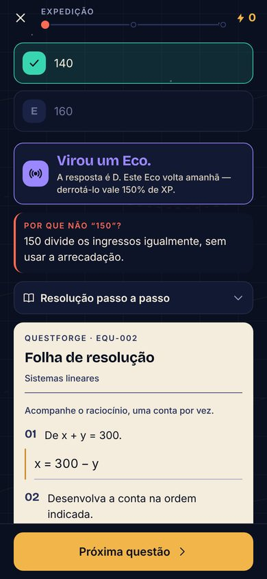

# Academia QuestForge

A Academia é a parte do app que **ensina**. O Atlas (missões, expedições e chefões) avalia;
a Academia explica o conteúdo, deixa experimentar, treina com ajuda e confirma o domínio sem
ajuda. As duas partes estão ligadas: cada questão do banco aponta para a etapa que ensina o que
ela exige, e o preparo na Academia aumenta o dano contra os chefões.

## O que há

| Curso | Aulas (etapas) | Subassuntos |
| --- | --- | --- |
| Matemática básica | Operações e expressões (6); Frações (7); Múltiplos, divisores, MMC e MDC (7); Potências e raízes (7); Notação científica (5) | 5 |
| Razão e proporção | Razão (5); Proporção (6); Regra de três simples (5); Regra de três inversa (5); Regra de três composta (5); Escala (6) | 6 |
| Porcentagem | Porcentagem (6); Variação percentual (5); Aumentos sucessivos (6) | 3 |
| Matemática financeira | Juros simples (6); Juros simples: comparar e decidir (5); Juros compostos (6); Juros compostos: depósitos, encargos e inflação (5); Compras a prazo (6); Custo-benefício (6) | 4 |
| Equações e sistemas | Equações do 1º grau (4); Sistemas lineares (4) | 2 |
| Funções | Função afim (4); Função quadrática (4); Função exponencial (4) | 3 |
| Geometria plana | Áreas e perímetros (4); Teorema de Pitágoras (4); Círculo e circunferência (4) | 3 |
| Geometria espacial | Volume e capacidade (4); Cilindros (4) | 2 |
| Grandezas e medidas | Conversão de unidades (4); Velocidade e tempo (4) | 2 |
| Gráficos e tabelas | Leitura de gráficos (4); Tabelas (4) | 2 |
| Estatística | Média aritmética e ponderada (4); Mediana e moda (4) | 2 |
| Probabilidade | Probabilidade simples (4); Probabilidade composta (5) | 2 |
| Análise combinatória | Princípio multiplicativo (4); Combinações (5) | 2 |

Ao todo: **13 cursos, 40 aulas e 197 etapas**, cobrindo os **38 subassuntos** do banco. São
143 laboratórios, 3 simulações, 230 exemplos guiados, 212 verificações, 1.074 geradores de
exercícios, 625 itens de prática e 689 de desafio. Todas as **644 questões** do banco estão
ligadas a uma etapa do seu subassunto, e as **2.576 alternativas erradas** têm uma nota que
explica o equívoco. Os números saem de `academyReport()`, `academyCoverage()` e
`distractorCoverage()` e são garantidos por testes.

## Como uma etapa funciona

Cada aula é uma sequência de etapas progressivas. Os tipos são **Descoberta**,
**Fundamentos**, **Interpretação**, **Aplicações**, **Aprofundamento** e **Maestria**; toda
aula termina numa Maestria. Cada etapa tem três modos, todos livres desde o início:

- **Aprender**: explicação em blocos curtos, fórmulas, callouts (ideia-chave, dica, atenção,
  ENEM, estratégia), dados, **laboratórios** com controles e uma missão, **simulações** de
  experimentos aleatórios, **exemplos guiados** em que o estudante escolhe o próximo passo antes
  de vê-lo, revelações e **verificações**. O botão "Continuar" só libera depois de cada atividade
  ser tentada — certa ou errada.
- **Praticar**: exercícios com dicas graduais ("lanterna"), feedback específico para cada erro
  previsível e resolução comentada. Os geradores criam versões novas a cada vez.
- **Desafiar**: em geral 3 problemas, sem dica nem resolução prévia. Até 3 itens, é preciso acertar todos;
  com mais, admite-se um erro. Passar marca a etapa como **dominada**.

Tipos de exercício: múltipla escolha, resposta numérica (aceita "3/8", "2 1/4", "R$ 12",
"15%", vírgula ou ponto), ordenar passos, achar o erro numa resolução, selecionar o que é
necessário, classificar em grupos e completar lacunas.

### Progresso, revisão e recompensas

`domain/academy/progress.ts` separa **vista**, **estudada** (explicação percorrida com as
verificações respondidas, ou prática com 2 acertos em 3 respostas) e **dominada** (desafio sem
ajuda). Etapas dominadas voltam para uma revisão rápida em 3, 7, 16 e 35 dias; errar a revisão
a remarca para o dia seguinte e reinicia os intervalos, sem tirar o domínio nem recompensas.

Recompensas (`domain/academy/rewards.ts`) pagam marcos uma vez só: estudar (15 XP, 2 Tinta),
praticar com aproveitamento (10 XP; acerto com dica conta meio), dominar (25 a 70 XP conforme o
tipo da etapa), revisar no prazo (12 XP) e a **insígnia de domínio** da aula inteira (80 XP, 25
Tinta). Há quatro títulos: Aprendiz da Academia, Estudioso, Erudito e Sábio do Atlas. Errar
nunca custa nada.

## Integrações com o jogo



- **Feedback das questões** (`features/question/Feedback.tsx`): depois de um erro, a nota da
  alternativa escolhida ("Por que não…?") e o atalho "Rever na Academia" para a etapa certa.
- **Resumo de expedições e missões** e **Acampamento**: recomendações de etapas a partir dos
  erros recentes, das dificuldades, das revisões vencidas e do próximo marco da campanha
  (`domain/academy/recommend.ts`).
- **Atlas**: cada região lista as aulas que preparam para as suas missões.
- **Chefões**: a tela de entrada mostra o preparo nas aulas do chefão; cada etapa dominada
  soma dano, até +15% (`bossPrepBonus`), que aparece também no HUD da batalha. Depois da luta,
  as etapas ligadas às questões erradas são sugeridas.
- **Diagnóstico por etapa** (`domain/academy/evidence.ts`): usa o estado das questões do Atlas
  ligadas à etapa. Poucos dados nunca viram veredito ("Poucos dados", "Vale revisar",
  "Dificuldade identificada", "Em construção", "Sólido").
- **Treino dirigido** (`domain/academy/drill.ts`): depois de estudar, 5 questões do Atlas ligadas
  à etapa — primeiro os Ecos, depois as inéditas.
- **Herói**: painel de insígnias de domínio.

## Onde fica o código

| Caminho | O quê |
| --- | --- |
| `src/content/academy/types.ts` | Modelo: curso → aula → etapa → corpo (`learn`, `practice`, `challenge`, `recap`) |
| `src/content/academy/kit/build.ts` | Construtores de blocos, exercícios, geradores, laboratórios e simulações |
| `src/content/academy/kit/format.ts` | Números em pt-BR (`num`, `fixed`, `brl`, `pct`, `frac`, `hm`, `qty`) |
| `src/content/academy/lessons/<curso>/` | As aulas, uma por arquivo, e o `index.ts` do curso |
| `src/content/academy/questionMap.ts` | Questão do banco → etapas (`aula/etapa`) |
| `src/content/academy/distractors/` | Nota de cada alternativa errada do banco |
| `src/content/academy/validation.ts` | Validador estrutural, matemático e pedagógico; relatórios de cobertura |
| `src/domain/academy/` | Correção, progresso, desafio, recompensas, recomendação, diagnóstico e treino |
| `src/app/(tabs)/academy.tsx`, `course.tsx`, `lesson.tsx`, `stage.tsx` | Telas |
| `src/features/academy/` | Blocos de aprendizagem, exercícios, laboratório, simulação e visualizações |

Persistência: tabelas `academy_progress` e `academy_answers` (migração 5) e campo `aca` do
snapshot de nuvem (schema 2). O desafio em andamento fica só no aparelho, como a batalha.

## Como escrever uma aula

1. Crie `lessons/<curso>/<aula>.ts` com `lesson({ id, topic, subtopics, title, summary, requires, stages })`
   e registre-a no `index.ts` do curso.
2. Cada etapa: `stage(id, tipo, título, objetivo, () => ({ learn, practice, challenge, recap }))`.
   O corpo é preguiçoso: só é montado quando a etapa abre.
3. Ligue as questões do banco em `questionMap.ts` e escreva as notas das alternativas erradas em
   `distractors/` (nunca na correta, nunca citando letras, explicando o equívoco ou conferindo
   com os dados).
4. Rode `npx jest src/content/academy` até o validador ficar vazio.

Regras de conteúdo que o validador exige ou que seguimos:

- "Aprender" com pelo menos 3 blocos e um interativo; exemplos com 2 passos ou mais; prática com
  dicas; resolução com conta; feedback de pelo menos 15 caracteres.
- Geradores testados em 120 sementes: pelo menos 4 versões diferentes, nenhum erro previsto
  igual à resposta ou repetido, alternativas entre 2 e 6.
- Laboratórios: missão alcançável e não cumprida no estado inicial; simulações com
  probabilidades que somam 1.
- Exclua dos geradores os números das questões do banco e dos exemplos da teoria (comentário
  `// questão do banco` / `// exemplo da teoria`) e use contextos com redação diferente.
- Contas exatas sempre que possível; "=" só quando o valor é exato, "≈" quando arredonda.
- Concordância: `qty(n, 'dia', 'dias')` para quantidades; campos explícitos (`fem`) em vez de
  trocas de texto.

## Verificação

```bash
npx jest src/content/academy src/domain/__tests__/academy.test.ts   # conteúdo, cobertura e domínio
EXPO_PUBLIC_QA=1 npx expo export --platform web --output-dir dist-web
python3 -m http.server 8090 --directory dist-web &
node scripts/e2e-academy.js e2e-academy-shots http://localhost:8090/
```

O roteiro e2e erra uma questão (nota e ponte para a Academia), abre um curso e uma aula,
cumpre a missão de um laboratório, percorre um exemplo guiado, recebe o feedback de uma
verificação, pratica com dica, confere que o Desafio não tem dicas e abre uma segunda aula.
Falha se houver erro no console.

## Limitações conhecidas

- A revisão independente do conteúdo foi feita pelo próprio autor das aulas (com verificadores
  mecânicos e leitura dos itens de Maestria e Aprofundamento); não houve revisão por professor
  externo nem teste com estudantes.
- Leitores de tela: os controles têm rótulos acessíveis e as visualizações têm descrição em
  texto, mas não houve teste com TalkBack em aparelho físico.
- Laboratórios usam controles deslizantes com passos fixos; não há manipulação livre das figuras.
